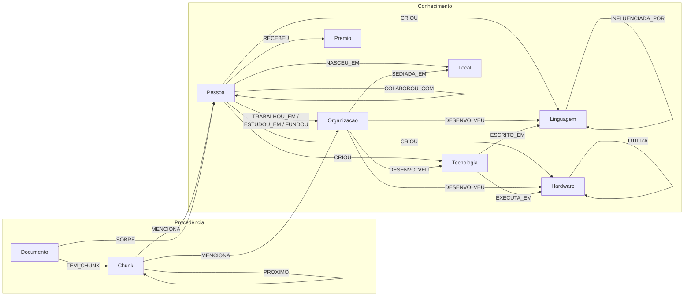

# Modelo LPG — História da Computação

Modelo de grafo de propriedades rotuladas (Labeled Property Graph) usado no Neo4j.
O grafo tem **duas camadas** ligadas entre si:

1. **Camada de conhecimento:** as entidades extraídas dos textos (pessoas, organizações, linguagens…) e as relações entre elas. É nela que acontece a travessia multi-hop.
2. **Camada de procedência:** os documentos da Wikipédia e os trechos (chunks) de onde cada entidade e relação foi extraída. É ela que permite citar a fonte de cada resposta e reduzir alucinações.

---

## Visão geral

> `SUCESSOR_DE` liga entidades do mesmo tipo (ex.: `Intel 8086 → Intel 8080`) e foi omitida do diagrama para não poluir.
> `MENCIONA` e `SOBRE` ligam a qualquer entidade; o diagrama mostra só dois exemplos.

---

## Nós da camada de conhecimento

Todo nó de entidade recebe **dois rótulos**: o rótulo específico (`:Pessoa`, `:Linguagem`…) e o rótulo genérico **`:Entidade`**. O rótulo genérico permite ter um único índice vetorial e um único índice fulltext para todas as entidades, o que simplifica a busca híbrida.

### Propriedades comuns a toda `:Entidade`

| Propriedade | Tipo | Obrigatória | Descrição |
|---|---|---|---|
| `id` | String | sim | Identificador canônico: `<tipo>:<nome_normalizado>`, ex.: `pessoa:alan_turing` |
| `nome` | String | sim | Nome canônico, ex.: `Alan Turing` |
| `aliases` | List&lt;String&gt; | não | Outras formas do nome, ex.: `["Turing", "Alan Mathison Turing"]` |
| `descricao` | String | não | Resumo de uma ou duas frases gerado na extração |
| `wikidata_id` | String | não | ID do Wikidata, quando a entidade tem página no dataset (ex.: `Q7251`) |
| `embedding` | List&lt;Float&gt; | não | Vetor de `nome + descricao`, para a busca vetorial |

### Rótulos específicos

| Rótulo | O que representa | Propriedades extras | Exemplos |
|---|---|---|---|
| `:Pessoa` | Pesquisadores, engenheiros, fundadores | `ano_nascimento`, `ano_morte` | Alan Turing, Grace Hopper |
| `:Organizacao` | Empresas, universidades, laboratórios, agências, fundações | `tipo` (`empresa`, `universidade`, `laboratorio`, `agencia`, `fundacao`), `ano_fundacao` | IBM, Bell Labs, MIT |
| `:Linguagem` | Linguagens de programação | `ano`, `paradigmas` (List) | C, Lisp, Python |
| `:Hardware` | Computadores, processadores, periféricos | `ano`, `tipo` (`computador`, `processador`, `periferico`) | ENIAC, Intel 4004, Rato |
| `:Tecnologia` | Sistemas operacionais, redes, protocolos, invenções, conceitos teóricos | `ano`, `tipo` (`sistema`, `rede`, `protocolo`, `invencao`, `conceito`) | Unix, ARPANET, Transistor, Máquina de Turing |
| `:Premio` | Prêmios e distinções | — | Prêmio Turing, Nobel de Física |
| `:Local` | Países e cidades | `tipo` (`pais`, `cidade`) | Reino Unido, Califórnia |

> `:Premio` e `:Local` não têm páginas próprias no dataset, mas aparecem muito nos textos e geram ótimas perguntas multi-hop
> (ex.: *"Quais ganhadores do Prêmio Turing trabalharam no Bell Labs?"*).

---

## Relações da camada de conhecimento

| Relação | De → Para | Propriedades extras | Exemplo |
|---|---|---|---|
| `TRABALHOU_EM` | Pessoa → Organizacao | `cargo`, `ano_inicio`, `ano_fim` | Dennis Ritchie → Bell Labs |
| `ESTUDOU_EM` | Pessoa → Organizacao | `curso`, `ano` | Alan Turing → Universidade de Cambridge |
| `FUNDOU` | Pessoa → Organizacao | `ano` | Bill Gates → Microsoft |
| `CRIOU` | Pessoa → Linguagem / Hardware / Tecnologia | `ano` | Guido van Rossum → Python |
| `DESENVOLVEU` | Organizacao → Linguagem / Hardware / Tecnologia | `ano` | Intel → Intel 4004 |
| `INFLUENCIADA_POR` | Linguagem → Linguagem | — | C → B |
| `ESCRITO_EM` | Tecnologia → Linguagem | — | Unix → C |
| `EXECUTA_EM` | Tecnologia / Linguagem → Hardware | — | Unix → PDP-11 |
| `UTILIZA` | Hardware → Hardware | — | Altair 8800 → Intel 8080 |
| `SUCESSOR_DE` | X → X (mesmo rótulo) | — | Intel 8086 → Intel 8080 |
| `RECEBEU` | Pessoa → Premio | `ano` | Ken Thompson → Prêmio Turing |
| `COLABOROU_COM` | Pessoa → Pessoa | `contexto` | Ritchie → Thompson |
| `NASCEU_EM` | Pessoa → Local | — | Alan Turing → Reino Unido |
| `SEDIADA_EM` | Organizacao → Local | — | Intel → Califórnia |

### Propriedades comuns a toda relação extraída

Toda relação da camada de conhecimento guarda de onde veio, para a rastreabilidade:

| Propriedade | Tipo | Descrição |
|---|---|---|
| `chunk_ids` | List&lt;String&gt; | IDs dos chunks em que a relação foi encontrada |
| `confianca` | Float (0–1) | Confiança da extração, informada pelo LLM ou calculada |
| `evidencia` | String | Trecho curto do texto que comprova a relação |

> Se a mesma relação aparecer em vários chunks, a Pessoa 3 acrescenta o novo ID em `chunk_ids` em vez de criar uma relação duplicada (`MERGE`).

---

## Camada de procedência

### Nós

| Rótulo | Propriedades | Descrição |
|---|---|---|
| `:Documento` | `id` (pageid), `titulo`, `url`, `categoria`, `wikidata_id`, `semente`, `data_coleta`, `licenca` | Uma página da Wikipédia (um arquivo de `data/raw/`) |
| `:Chunk` | `id` (`<pageid>_<ordem>`), `texto`, `ordem`, `embedding` | Um trecho do documento, a unidade de extração e de busca vetorial |

### Relações

| Relação | De → Para | Descrição |
|---|---|---|
| `TEM_CHUNK` | Documento → Chunk | O documento é dividido nesses trechos |
| `PROXIMO` | Chunk → Chunk | Ordem de leitura, para recuperar o contexto vizinho |
| `MENCIONA` | Chunk → Entidade | A entidade aparece no trecho |
| `SOBRE` | Documento → Entidade | A página é sobre essa entidade (ex.: página "Alan Turing" → `pessoa:alan_turing`) |

---

## Constraints

| Constraint | Garante |
|---|---|
| `Entidade.id` único | Nenhuma entidade duplicada (base da resolução de entidades) |
| `Pessoa.id`, `Organizacao.id`, `Linguagem.id`, `Hardware.id`, `Tecnologia.id`, `Premio.id`, `Local.id` únicos | Unicidade por tipo, usada pelos `MERGE` da ingestão |
| `Documento.id` único | Uma página = um nó |
| `Documento.url` único | Mesma página não entra duas vezes |
| `Chunk.id` único | Trecho não duplicado |
| `Entidade.nome` não nulo | Toda entidade tem nome (constraint de existência: só no Enterprise; no Community é validada no código) |

## Índices

| Tipo | Onde | Para quê |
|---|---|---|
| **Range (BTree)** | `Entidade.nome`, `Documento.categoria`, `Documento.titulo`, `Linguagem.ano`, `Hardware.ano`, `Tecnologia.ano` | Filtros e buscas exatas no Cypher (`WHERE p.nome = ...`, `WHERE l.ano < 1970`) |
| **Fulltext** | `Entidade(nome, aliases, descricao)` | Achar entidades por nome aproximado ou por apelido (ex.: "Turing" → Alan Turing) |
| **Fulltext** | `Chunk(texto)` | Busca por palavras-chave nos textos |
| **Vector** (cosseno) | `Chunk.embedding` | Busca semântica nos trechos |
| **Vector** (cosseno) | `Entidade.embedding` | Achar a entidade mais parecida com a pergunta (ponto de partida da travessia) |

### Modelo de embedding (decidido)

| Item | Valor |
|---|---|
| Modelo | [`intfloat/multilingual-e5-base`](https://huggingface.co/intfloat/multilingual-e5-base) (via `sentence-transformers`) |
| Dimensão | **768** (é o valor usado nos dois índices vetoriais) |
| Similaridade | cosseno |
| Tamanho máximo de entrada | 512 tokens (os chunks devem respeitar esse limite) |

Por que este modelo: é gratuito e roda localmente (sem custo de API), entende português e aceita trechos longos (512 tokens), enquanto modelos como o `paraphrase-multilingual-mpnet-base-v2` cortam o texto em 128 tokens.

**Atenção (Pessoas 3 e 4):** o E5 exige um prefixo no texto antes de gerar o embedding:
- ao indexar chunks e entidades: `"passage: " + texto`
- ao buscar a partir da pergunta do usuário: `"query: " + pergunta`

Sem o prefixo, a qualidade da busca cai bastante. Os vetores devem ser normalizados (`normalize_embeddings=True`).

---

## Exemplos de perguntas multi-hop que o modelo suporta

| Pergunta | Caminho no grafo | Saltos |
|---|---|---|
| Que linguagens foram criadas por pessoas que trabalharam no Bell Labs? | `Organizacao ← TRABALHOU_EM ← Pessoa → CRIOU → Linguagem` | 2 |
| Qual sistema foi escrito na linguagem criada por Dennis Ritchie, e em que máquina ele rodava? | `Pessoa → CRIOU → Linguagem ← ESCRITO_EM ← Tecnologia → EXECUTA_EM → Hardware` | 3 |
| Qual empresa fundada por ex-funcionários da Fairchild fez o processador usado no Altair 8800? | `Hardware → UTILIZA → Hardware ← DESENVOLVEU ← Organizacao ← FUNDOU ← Pessoa → TRABALHOU_EM → Organizacao` | 4 |
| Quais ganhadores do Prêmio Turing estudaram na mesma universidade que Alan Turing? | `Pessoa → ESTUDOU_EM → Organizacao ← ESTUDOU_EM ← Pessoa → RECEBEU → Premio` | 3 |
| De que linguagens o Python herdou ideias, e quem as criou? | `Linguagem → INFLUENCIADA_POR → Linguagem ← CRIOU ← Pessoa` | 2 |